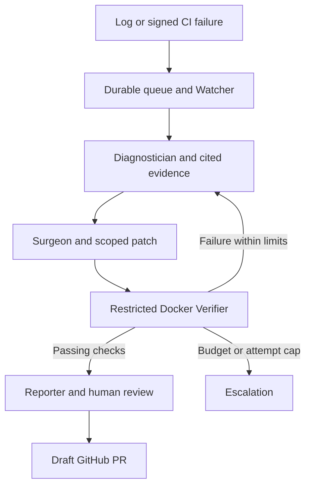

# IRONCLAD — Autonomous Code Guardian

**Detect. Diagnose. Repair. Verify. Review.**

IRONCLAD is a single-repository AI repair workbench with six agent roles, an event-sourced workflow, a live mission-control dashboard, isolated verification, and human-reviewed draft pull requests. This repository contains the phased implementation; milestone branches preserve each delivered phase.

## What you can run

- **Supervisor** enforces scope, persistent model reservations, step and attempt caps, repeated-patch detection, and escalation.
- **Watcher** accepts logs and signed failed-CI webhooks.
- **Diagnostician** cites AST-extracted Python functions/classes and validates model output.
- **Surgeon** proposes minimal edits restricted to cited files; denied paths, symlinks, ambiguous replacements and invalid Python are rejected.
- **Verifier** compares baseline and patched pytest failures in fresh restricted Docker containers, and requires lint, type and security checks.
- **Reporter** prepares the review summary and opens a draft GitHub PR after explicit diff review.

The Next.js dashboard includes Overview, Incidents, Incident workspace, Replay, PR review, Knowledge and Settings. All synthetic demo events carry a simulation marker. Simulation runs cannot be approved or published.

## Quick start: dashboard

Requirements: Python 3.12+, Node.js 22+, Git. Actual code verification also requires Docker.

```bash
git clone https://github.com/veereshawaralli/IRONCLAD.git
cd IRONCLAD
python -m venv .venv
# Windows PowerShell: .venv\Scripts\Activate.ps1
# Linux/macOS: source .venv/bin/activate
python -m pip install -e ".[dev]"
cd web
npm ci
npm run build
cd ..
```

Set a random installation access token (at least 24 characters):

```bash
# Linux/macOS
export IRONCLAD_ADMIN_TOKEN="$(python -c 'import secrets; print(secrets.token_urlsafe(32))')"
python -m uvicorn ironclad.api:create_app --factory --host 127.0.0.1 --port 8000
```

Windows PowerShell:

```powershell
$env:IRONCLAD_ADMIN_TOKEN = python -c "import secrets; print(secrets.token_urlsafe(32))"
python -m uvicorn ironclad.api:create_app --factory --host 127.0.0.1 --port 8000
```

Open **http://localhost:8000**, sign in using your installation token, and choose **Explore demo**. The demo is a recorded synthetic scenario; no code or model runs. The standalone CLI remains available:

```bash
python -m ironclad.cli run --repo examples/broken_repo --log examples/failure.log
python -m ironclad.cli replay RUN_ID
python -m ironclad.cli export RUN_ID --output proposed.patch
```

## Real repair execution

Build the sandbox image, configure one local target repository, then start one worker in a second terminal:

```bash
docker build -f Dockerfile.sandbox -t ironclad-sandbox:local .
# Set IRONCLAD_REPO to an absolute path to your Python repository.
# API and worker must use the same IRONCLAD_DB and IRONCLAD_REPO.
python -m ironclad.worker
```

Set the hosted model variables in `.env.example` in the API/worker environment. Supply real provider prices and one chat-completions-compatible coding model. **New incident** uses hosted mode when configured; otherwise it supports the bundled empty-input fixture. The worker refuses host execution when Docker is unavailable. Non-Python assets, arbitrary dependency installation, and external service integration tests are outside the initial verifier image's supported target.

A failing baseline is required before a fix can pass. The verifier rejects patches that fail tests, lint, types or Bandit. Failed checks return feedback to the next diagnostic step. Three attempts maximum; repeated identical patches escalate sooner. CLI Phase 1 only proposes; the dashboard worker executes the complete bounded graph.

## Draft GitHub PRs

Set `IRONCLAD_GITHUB_REPO=owner/repo` and a fine-grained `IRONCLAD_GITHUB_TOKEN` limited to that repository with contents and pull-request write permissions. The local checkout must match the intended target revision. Review a passing incident's diff and checks, confirm review, then create its draft PR. The remote file hashes are checked against the original diagnosis before publication. Changed code is rejected. No auto-merge exists.

For CI ingestion, configure `/api/webhooks/github` with a high-entropy `IRONCLAD_WEBHOOK_SECRET` and check-run events. Signatures, repository scope and delivery IDs are checked. Duplicate deliveries reuse the run. CI head SHA is recorded; automatic checkout of arbitrary webhook revisions is deliberately not performed.

No co-author trailers or assistant attribution are generated by the application.

## Docker Compose

Copy `.env.example` to `.env`, set the admin token, provider/GitHub credentials as needed, and `IRONCLAD_REPO_HOST` to the target repository's absolute host path. Then:

```bash
docker build -f Dockerfile.sandbox -t ironclad-sandbox:local .
docker compose up --build
```

The API binds localhost only. Shared state uses a volume. The worker has the Docker socket so it can launch restricted sibling sandboxes; **run this installation on a dedicated development machine or VM** because Docker socket access gives the worker control over the Docker host. Target-generated code never receives that socket, credentials, host network, or the full repository. Shared sandbox temp paths have the same absolute path in worker and host.

Before exposing remotely, use a TLS reverse proxy, set `IRONCLAD_SECURE_COOKIE=1`, and keep installation credentials private. There is no multi-tenant authorization model.

## Architecture



Every agent transition is recorded in an immutable event log. Reconnecting clients supply the last sequence number; the server sends subsequent events. Replay reads recorded outputs without invoking models or executing code. Concise evidence-based rationales are stored, not private model chain-of-thought.

### Decisions and limits

| Area | Implementation and trade-off |
| --- | --- |
| Graph | Explicit bounded transitions; no uncontrolled autonomous loop. Repair iterations are bounded and repeated diffs are detected. |
| Durability | SQLite WAL is the zero-service default; `IRONCLAD_DATABASE_URL` enables PostgreSQL for event history, queue, settings and budget reservations. `IRONCLAD_REDIS_URL` enables durable typed Streams mirroring with catch-up. One worker per installation is supported. |
| Retrieval | AST chunks ranked with BM25 and exact-symbol boosts. Optional pgvector embeddings combine with BM25 through reciprocal-rank fusion; stale indexed chunks are excluded. |
| Model spend | Calls reserve conservative configured estimates in durable storage before network requests. Actual billing depends on provider prices/accounting; configure provider-side caps for a financial ceiling. |
| Crash recovery | Recorded steps replay exactly. Interrupted executing jobs escalate instead of repeating unknown side effects. Resume does not reconstruct historical filesystem snapshots. |
| Isolation | Fresh non-root, network-disabled, read-only containers with capability/PID/CPU/memory/time limits. No fallback to host execution. Docker itself remains a required trusted boundary. |
| Review | Separate review confirmation and publication gates; only draft PRs. Existing PRs are reused. |
| UI | Next.js 15 / React 19 / strict TypeScript and custom CSS. Static export is served by FastAPI. This replaces the proposed Tailwind/shadcn state-library stack to keep the initial installation smaller. TanStack Virtual renders incident rows efficiently; the current API caps the feed at 1,000 records. |
| Observability | Structured event logs, authenticated Prometheus-format counters and optional per-step OpenTelemetry OTLP export. |

## Repository map

```text
ironclad/         schemas, agents, event store, model adapter, sandbox,
                  API, worker, review gates and GitHub publisher
web/              Next.js dashboard and responsive design system
tests/            unit, API, workflow, webhook and publication tests
examples/         deliberately broken Python fixture and failure log
design/           original shared design tokens
docs/             phase notes, JSON schemas, validation and load results
scripts/          localhost-only WebSocket fan-out test
Dockerfile        dashboard + API/worker image
Dockerfile.sandbox restricted verification tool image
compose.yml       local API/worker deployment
```

## Validation

```bash
python -m ruff check ironclad tests
python -m mypy ironclad
python -m pytest --cov=ironclad --cov-report=term-missing
cd web && npm run typecheck && npm run build
```

See [VALIDATION.md](VALIDATION.md) for measured results and remaining verification limits. Docker and live provider/GitHub execution were not available for an end-to-end real-repository repair during development. Mocked integration tests establish program behaviour, not production security or a guarantee that generated fixes are correct.

The original broad acceptance targets—live Docker/service validation, full WCAG audit, sustained 500-dashboard workload and under-200ms live latency—must not be inferred from the current validation results. Service-backed and Docker smoke jobs are included in GitHub Actions.


## Optional production services and semantic index

```bash
python -m pip install -e ".[production]"
# Configure .env with a URL-safe IRONCLAD_POSTGRES_PASSWORD and embedding settings.
docker compose -f compose.yml -f compose.production.yml up --build
```

Set `IRONCLAD_DATABASE_URL` for local Python use; Compose's production override sets it for API and worker. An optional pgvector index uses `IRONCLAD_EMBEDDING_KEY`, `IRONCLAD_EMBEDDING_MODEL`, `IRONCLAD_EMBEDDING_DIMENSIONS`, and the actual `IRONCLAD_EMBEDDING_USD_PER_MILLION`. Build explicitly:

```bash
python scripts/index_repo.py --repo /absolute/repo --budget 1.00
```

Embedding inputs are repository source. Index builds reserve an explicit bounded budget before every request. Runtime embedding retrieval shares incident budgets; standalone knowledge queries have a durable installation-wide reservation cap. Without embeddings, BM25 remains available. The index is replaced atomically; retrieval also rejects stale source digests.

Optional `IRONCLAD_OTLP_ENDPOINT` exports agent spans using the run ID as trace ID. `IRONCLAD_REDIS_URL` mirrors committed messages into per-run Streams; the PostgreSQL/SQLite log remains authoritative when Redis is unavailable. This is one installation, not a distributed multi-tenant service.
